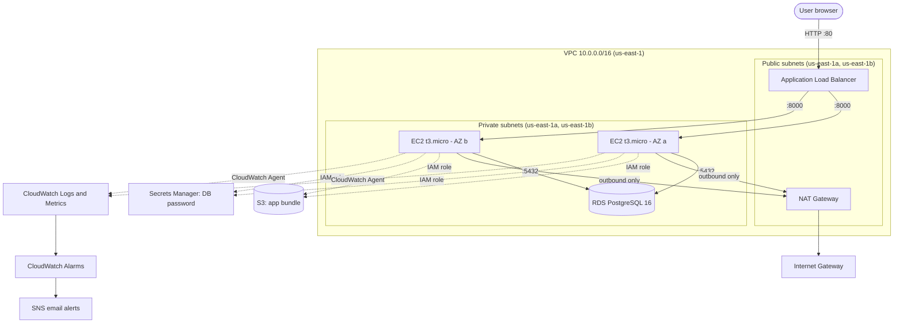
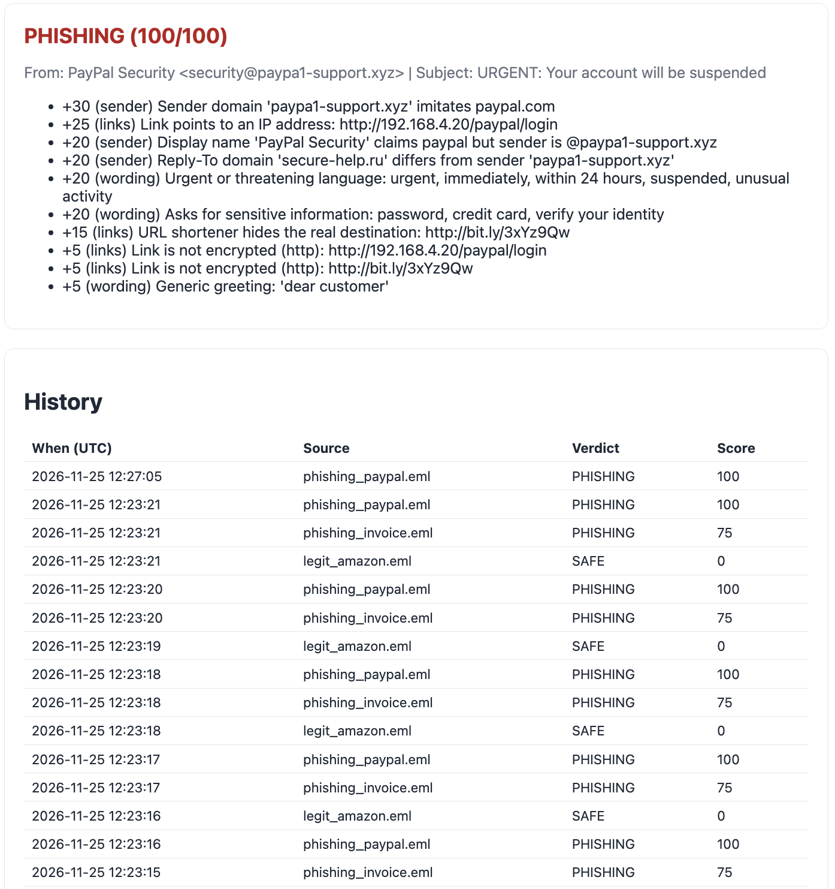
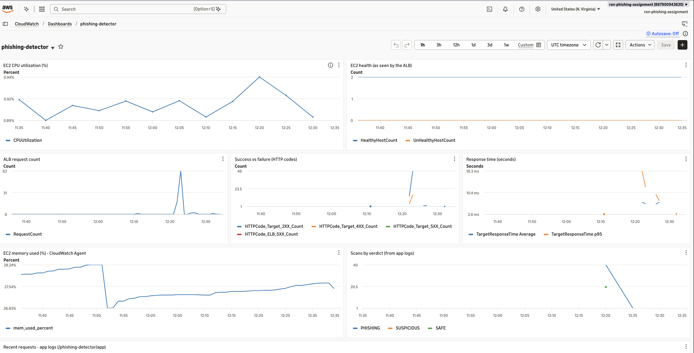
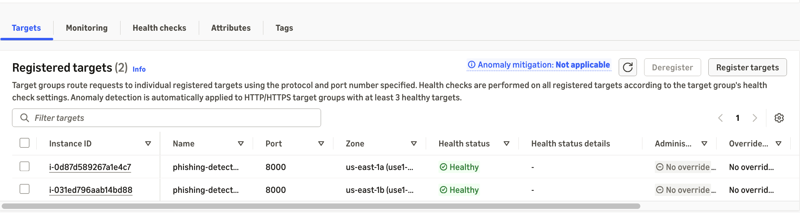
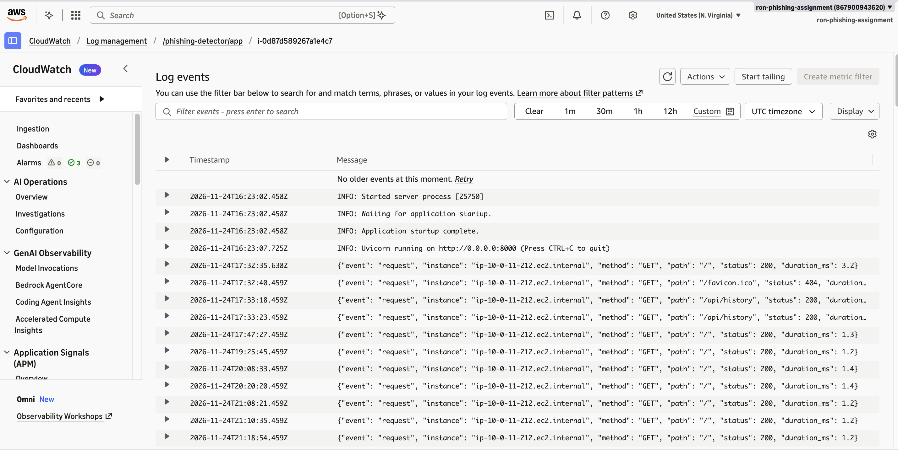
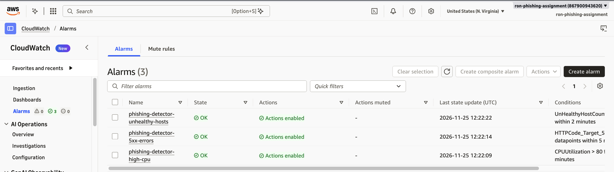
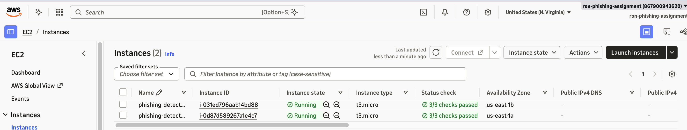

# Phishing Detector on AWS

An email phishing detector (Python / FastAPI) deployed on AWS with Terraform:
two EC2 instances behind an Application Load Balancer, PostgreSQL on RDS, and
CloudWatch monitoring with alarms.

> Home assignment for the Cloud Monitoring Engineer position.

---

## Repository structure

```
app/
  detector/
    parser.py            # parse .eml / raw text: headers, body, links, attachments
    checks/
      sender.py          # spoofed / look-alike sender, Reply-To mismatch
      links.py           # IP URLs, shorteners, suspicious TLDs, punycode, http
      wording.py         # urgency, requests for sensitive data, generic greeting
      attachments.py     # executables, double extensions, macros, archives
    scoring.py           # combines all checks into a 0-100 score + verdict
  history.py             # scan history (SQLAlchemy; SQLite locally, PostgreSQL on RDS)
  main.py                # FastAPI: UI, /api/scan, /api/history, /health, JSON logging
  static/index.html      # simple UI: upload or paste an email, see result + history
cli.py                   # command-line scanner
samples/                 # example emails (2 phishing, 1 legitimate)
terraform/               # all AWS infrastructure
docs/screenshots/        # screenshots of the running environment
```

---

## Part 1 - Phishing detector

### How it works

1. **Parse**: the email is read as bytes and parsed with Python's `email` library,
   which handles headers, multipart bodies, charsets and attachments.
2. **Check**: four independent checks each return a list of findings
   (`check`, `points`, `reason`).
3. **Score**: points are summed and capped at 100, then mapped to a verdict.
4. **History**: every scan is saved to the database.

### Indicators and points

| Check | Indicator | Points |
|---|---|---|
| Sender | Domain imitates a known brand (e.g. `paypa1-support.xyz`) | +30 |
| Sender | Display name claims a brand but the domain is different | +20 |
| Sender | `Reply-To` domain differs from `From` domain | +20 |
| Links | URL points to a raw IP address | +25 |
| Links | Punycode domain (`xn--`) | +20 |
| Links | URL shortener (bit.ly, tinyurl, ...) | +15 |
| Links | Suspicious TLD (.xyz, .top, .ru, ...) | +15 |
| Links | Unencrypted `http://` link | +5 |
| Wording | Urgent or threatening language (5 per phrase, max 20) | up to +20 |
| Wording | Asks for passwords, card numbers, etc. | +20 |
| Wording | Generic greeting ("Dear customer") | +5 |
| Attachments | Executable (.exe, .js, .scr, ...) | +30 |
| Attachments | Office file with macros (.docm, .xlsm) | +25 |
| Attachments | Double extension (`invoice.pdf.exe`) | +20 |
| Attachments | Archive (.zip, .rar, .7z) | +10 |

**Verdict:** `SAFE` 0-29, `SUSPICIOUS` 30-69, `PHISHING` 70-100.

The checks are rule-based, so every point in the score has a readable reason.
Possible improvements: SPF/DKIM/DMARC header checks, comparing link text with
the real URL, domain-age and reputation lookups.

### Run locally

```bash
python3 -m venv .venv && source .venv/bin/activate
pip install -r requirements.txt

# CLI
python cli.py samples/phishing_paypal.eml
python cli.py --history

# Web UI at http://localhost:8000
uvicorn app.main:app --reload
```

Locally the history is stored in SQLite (`history.db`). On AWS the same code
uses PostgreSQL. Only the `DATABASE_URL` environment variable changes.

---

## Part 2 - AWS infrastructure

### Architecture



**Request flow:** browser → ALB (public subnet, port 80) → one of two EC2
instances (private subnets, port 8000) → RDS (private subnet, port 5432).

### Terraform files

| File | What it creates |
|---|---|
| `versions.tf` | Terraform / provider versions, default tags on every resource |
| `variables.tf` | Region, project name, VPC CIDR, instance type, alert email |
| `network.tf` | VPC, 2 public + 2 private subnets in 2 AZs, Internet Gateway, NAT Gateway, route tables |
| `security.tf` | Security groups: ALB → app → DB chain |
| `rds.tf` | PostgreSQL 16 on RDS (private, encrypted, password managed by AWS) |
| `iam.tf` | IAM role for EC2 with least-privilege permissions |
| `s3.tf` | Private S3 bucket + zipped application code |
| `compute.tf` | Launch template, Auto Scaling Group (2 instances), ALB, target group, listener |
| `user_data.sh.tpl` | Boot script: installs the app, reads the DB secret, runs it with systemd, starts the CloudWatch Agent |
| `monitoring.tf` | CloudWatch dashboard, log metric filter, alarms, SNS email topic |
| `outputs.tf` | DB endpoint and secret ARN (app URL and dashboard URL are in `compute.tf` / `monitoring.tf`) |

### Deploy

Requirements: Terraform >= 1.6 and the AWS CLI configured with credentials
(`aws configure`).

```bash
cd terraform
echo 'alert_email = "you@example.com"' > terraform.tfvars   # git-ignored
terraform init
terraform apply
```

* RDS takes about 8 minutes to create; the rest takes about 5 minutes.
* After `apply`, confirm the SNS subscription email to receive alerts.
* The servers need 3-5 minutes after `apply` to install the app. Then:

```bash
curl "$(terraform output -raw app_url)/health"
# {"status":"ok","instance":"ip-10-0-11-212.ec2.internal"}
```

Calling `/health` several times shows two different instance names, which
confirms that the ALB balances traffic across both servers.

---

## Monitoring

Everything is on one CloudWatch dashboard (`dashboard_url` output).

| Question from the assignment | Where to see it |
|---|---|
| Are the EC2 instances healthy? | `HealthyHostCount` / `UnHealthyHostCount` on the dashboard, target group "Targets" tab, alarm `unhealthy-hosts` |
| How much CPU / system resources? | EC2 `CPUUtilization`; memory and disk from the CloudWatch Agent (EC2 does not report these by itself); alarm `high-cpu` |
| How many requests reach the ALB? | ALB `RequestCount` |
| Are requests succeeding or failing? | `HTTPCode_Target_2XX/4XX/5XX_Count` and `HTTPCode_ELB_5XX_Count`; alarm `5xx-errors`; response time (average and p95) |
| Where are the application logs? | CloudWatch Logs group `/phishing-detector/app`, one log stream per instance; recent requests are shown in a table on the dashboard |

**Business metric:** a log metric filter turns the app's `scan` log events into
a `Scans` metric split by verdict (PHISHING / SUSPICIOUS / SAFE), with no code
changes.

**Structured logs:** the app writes one JSON line per request and per scan, for
example:

```json
{"event": "request", "instance": "ip-10-0-11-212.ec2.internal", "method": "POST", "path": "/api/scan", "status": 200, "duration_ms": 6.0}
```

Useful CloudWatch Logs Insights queries:

```
# All server errors
fields @timestamp, instance, path, status | filter status >= 500 | sort @timestamp desc

# Slowest endpoints
stats avg(duration_ms), max(duration_ms), count(*) by path

# Traffic per instance (load-balancing check)
filter event = "request" | stats count(*) by instance
```

**Alarms** (sent by email through SNS):

| Alarm | Fires when |
|---|---|
| `unhealthy-hosts` | Any instance fails the `/health` check for 2 minutes (also sends "OK" when it recovers) |
| `5xx-errors` | More than 5 server errors in 5 minutes |
| `high-cpu` | Average CPU above 80% for 10 minutes |

---

## Design decisions

### Availability
* Two EC2 instances in **two Availability Zones**. If one AZ fails, the other
  keeps serving traffic.
* The ALB runs in both AZs and only sends traffic to instances that pass the
  health check.

### Reliability
* **Auto Scaling Group** with `health_check_type = "ELB"`: if an instance fails
  the ALB `/health` check, the ASG terminates it and launches a new one.
* The app runs as a **systemd service** with `Restart=always`, so a crashed
  process is restarted within seconds.
* `/health` is deliberately **shallow** (it does not query the DB). If the
  database has a problem, the ALB should not mark every instance unhealthy and
  replace all of them, which would turn a DB problem into a full outage. DB
  problems show up as 5xx errors and trigger the `5xx-errors` alarm.
* Code changes produce a new S3 object name, which updates the launch template,
  and the ASG **instance refresh** replaces servers one at a time (50% stay healthy).
* RDS automated backups are enabled. DB writes run in transactions.

### Security
* EC2 and RDS are in **private subnets** with no public IP. Only the ALB is
  reachable from the internet.
* **Security group chain:** internet → ALB (80) → app (8000, only from the ALB
  SG) → DB (5432, only from the app SG).
* **No SSH and no key pairs.** Shell access is through SSM Session Manager.
* The **DB password** is generated and stored by RDS in **Secrets Manager**
  (`manage_master_user_password`). It never appears in code, Git, or the
  Terraform state. The server reads it at boot.
* RDS storage is **encrypted**, and the app connects with `sslmode=require`.
* **IMDSv2 required** on the instances, which protects the role credentials
  from SSRF-style attacks.
* The S3 bucket has **all public access blocked**.
* The app runs as an unprivileged system user, and the env file with the DB
  URL is readable only by root.
* App-level: uploads are limited to 5 MB, and email content is inserted into
  the page with `textContent` (no HTML injection / XSS).
* `.gitignore` excludes `*.tfstate`, `*.tfvars` and credential files.

### Permissions
* The EC2 instances use an **IAM role** (instance profile). There are no
  access keys on the servers.
* **Least privilege:** the custom policy allows only `GetSecretValue` on
  **this one secret** and `GetObject` on **this one bucket**, plus the
  AWS-managed policies for SSM and the CloudWatch Agent.
* My personal IAM user (`AdministratorAccess`, MFA) is used only to run
  Terraform. In a team I would use IAM Identity Center (SSO) and a CI/CD role.

---

## Cost and trade-offs

The environment is sized for the $100 credit and was destroyed after each work
session.

| Choice | Why | In production I would... |
|---|---|---|
| One NAT Gateway (in one AZ) | NAT is billed per hour | Use one NAT per AZ, or VPC endpoints for S3 / SSM / CloudWatch so private instances don't need NAT |
| RDS single-AZ, 1-day backups | Cost | Enable Multi-AZ (automatic failover) and longer backup retention |
| HTTP only (no HTTPS) | HTTPS on an ALB requires a domain and a certificate | Add an ACM certificate + HTTPS listener and redirect HTTP to HTTPS |
| App code downloaded from S3 at boot | Simple, no image pipeline | Bake an AMI (Packer) or use containers (ECS), so new instances start faster |
| DB secret read once at boot | Simple | RDS rotates the managed password every 7 days, so the app should re-read the secret on authentication failure |
| Tables created by the app on startup | Simple | Use migrations (Alembic) as a separate deploy step |
| No scaling policy (fixed 2 instances, max 4) | Load is tiny | Add target tracking on CPU or `RequestCountPerTarget` |
| t3.micro / db.t4g.micro | Cheapest sizes | Size by measured load |

---

## Problems I hit and how I solved them

* **ASG failed on the first apply** with "Access denied when attempting to
  assume role AWSServiceRoleForAutoScaling". In a new account AWS creates this
  service-linked role on first use, and it was not yet available when the ASG
  tried to use it (a race condition). I verified the role existed with
  `aws iam get-role`, and the second `terraform apply` replaced the failed ASG.
* **`templatefile` error** in `user_data.sh.tpl`: a comment contained `${...}`,
  and Terraform tried to interpolate it. Values meant for the server (not for
  Terraform) are escaped as `$${...}`.
* **No `set -x` in user data**: it would print the DB password to the boot log.
* **Local testing against PostgreSQL**: port 5432 was taken by a local
  PostgreSQL, so the test container ran on 5433. "Password authentication
  failed" meant I was connecting to the wrong server. A network block (security
  group) would show up as a timeout instead.

---

## Tear down

```bash
cd terraform
terraform destroy
```

Verify that nothing is left:

```bash
terraform state list                                  # empty
aws ec2 describe-instances --filters Name=tag:Project,Values=phishing-detector \
    Name=instance-state-name,Values=pending,running \
    --query 'Reservations[].Instances[].InstanceId'   # []
aws rds describe-db-instances --query 'DBInstances[].DBInstanceIdentifier'      # []
aws elbv2 describe-load-balancers --query 'LoadBalancers[].LoadBalancerName'    # []
aws ec2 describe-nat-gateways --filter Name=state,Values=available \
    --query 'NatGateways[].NatGatewayId'                                        # []
```

---

## Screenshots

**The app running on AWS (scan result + history stored in RDS)**


**CloudWatch dashboard**


**Both targets healthy behind the ALB**


**Application logs in CloudWatch (JSON, one stream per instance)**


**Alarms**


**Two instances in two AZs, no public IP**
